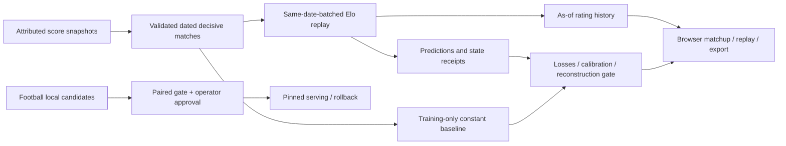

# SpOps — Matchday & Sports Model Lab

**Follow a game. Ask a question. Keep the source. Then inspect the model.**

Personal MLOps project by Dilip Nallamasa. Repository/hosting identifiers remain wc26-mlops.

> Redevelopment branch: improve/multisport-release. Public site: https://fifa2026mlops.vercel.app/. Verify the hosted commit at /release.json and its corresponding CI/browser records; source in a branch does not by itself certify a public deployment. Publication and deployment follow explicit release approval.

## Use the product

The locally prepared Matchday expansion adds eight competition adapters (NBA, Premier League, NFL, MLB, NHL, ATP Tour, Sheffield Shield and Formula 1), bounded current score snapshots, source-grounded game Q&A, browser watchlists, spoiler controls, match briefs/calendar downloads, dynamic sport graphics and official click-to-load signature-play videos. The dated historical model lab remains separate. See [the matchday architecture and coverage contract](docs/matchday-platform.md). This expansion is not certified as deployed until its exact-source release gates pass.

Basketball/NBA, NFL and cricket/IPL have real historical outcome snapshots, date-batched Elo replays, matchup scenarios with a selected as-of date, constant baselines, calibration tables and downloadable receipts. No paid API, LLM call or remote serving backend is required for these workbenches.

The football/WC26 archive retains its ensemble, bracket simulation, prediction history and PELE comparison with their existing limitations. The daily cloud schedule is disabled after the tournament. NASCAR is not implemented; unbacked probability tables are removed from its preserved route.

## Run locally

```powershell
cd dashboard
npm ci
npm run build
npm start -- --hostname 127.0.0.1 --port 3260
```

Open http://127.0.0.1:3260/. Fonts and replay snapshots are served locally. First-time dependency installation needs network; the historical demo and replay computation need no API credentials. Matchday tries documented free public providers on demand; offline results use dated captured snapshots where available, otherwise show an unavailable state. Do not run the old daily pipeline to view the website.

## Architecture



Binary sport plugins do not coerce football's three-outcome model into another sport. Existing local governance separates candidate registration from approval, preserves loaded artifact identity and supports exact rollback. The weaker temporal-stack replacement remains rejected.

## Historical results

Dates and parameters were frozen at 1fcaa39 before new-sport scores were inspected. Each date is scored before its outcomes update ratings. Earlier evaluation dates may inform later ones: this is retrospective prequential evaluation, not a globally untouched prospective study.

| Sport | Games | Elo log loss | Constant log loss | Elo summed Brier | Constant summed Brier |
| --- | ---: | ---: | ---: | ---: | ---: |
| basketball | 1311 | 0.607606 | 0.682653 | 0.418985 | 0.489515 |
| nfl | 251 | 0.654006 | 0.689788 | 0.457445 | 0.496618 |
| cricket | 73 | 0.696754 | 0.691819 | 0.503685 | 0.498672 |

Lower losses are better. Elo has lower point losses for basketball/NFL on these intervals. **Cricket's constant baseline performs better; that negative result is retained.** No significance, future superiority or betting-profit claim follows. New sports condition on a decisive winner; ties/no-results are excluded and counted.

Coverage: NBA through June 2015, NFL through December 2015, IPL through May 2023. Every workbench shows its exact data date. [Protocol](docs/multisport-replay-protocol.json) · [Sources/licenses](data/multisport/sources.json).

## Reproduce offline

```powershell
python scripts/build_multisport_replays.py
python -m pytest tests/test_match_replay.py tests/test_multisport_artifacts.py -q
python -m pytest tests/ -q --basetemp validation/test-run
```

Use Python 3.10 with the compatible project scientific environment. The new replay core uses the standard library. Existing Linux/Windows dependency boundaries are documented in the governance report; do not regenerate the Linux lock from Windows. Artifact tests rebuild all predictions, ratings and losses from committed scores and verify public-byte fingerprints.

Optional online ingestion: scripts/fetch_multisport_snapshots.py. Evaluation does not refetch data. NBA/NFL sources are upstream-commit-pinned. Cricsheet's rolling ZIP is hashed and retained in local recovery evidence. Normalized data includes attribution, exclusions and upstream notices.

## Inspect the engineering

- [Governed promotion and rollback](docs/governed-promotion.md)
- [Rejected temporal experiment](docs/temporal-stack-results.md)
- [PELE benchmark and qualifications](docs/pele-benchmark-summary.md)
- [Multi-sport design](docs/multisport-design.md)
- [Fifteen-idea decisions](docs/extension-decisions.md)

Browser tests run only on GitHub runners; no local desktop/browser control. Current validation and later CI results belong in the release report. Presence of MLflow, Airflow, Render, Supabase, Prometheus/Grafana and Kubernetes configurations does not certify current cloud health. The new workbenches require none of those services. Local football serving fails without an approved artifact instead of training a replacement during an outage.
